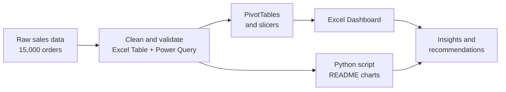

# Retail & E-commerce Sales and Profitability Analysis

> Where does the money come from, and where does it leak away? An Excel + Python analysis of **15,000 orders** (2023–2025) from a retail and e-commerce business.

**Quick answer:** the business sells a lot, but it keeps only **5.3 cents of profit on every $1 of sales**. The main reason is **discounting**: discounts take away **75% of the gross profit**.

**Contents**

1. [Introduction](#1-introduction)
2. [Project Structure](#2-project-structure)
3. [Tools and Technologies](#3-tools-and-technologies)
4. [Data Exploration](#4-data-exploration)
5. [Step-by-Step Analysis (Phases 1–6)](#5-step-by-step-analysis)
6. [Pros: What Works Well](#6-pros-what-works-well)
7. [Cons: What Hurts Profit](#7-cons-what-hurts-profit)
8. [How to Solve the Cons](#8-how-to-solve-the-cons)
9. [Recommendations](#9-recommendations)
10. [Summary](#10-summary)

---

## 1. Introduction

### Business problem
A retail and e-commerce company sells office supplies, furniture and technology products through three channels (online, retail store, distributor) in 16 US states. Sales look healthy, but management wants to know **how much profit is really made** and **what is reducing it**.

### Goal of this project
- Measure real sales and profit (after discounts and shipping).
- Find which products, regions, customers and discount levels make or lose money.
- Give clear, practical actions to improve profit.

### Questions I answer
1. How much profit does the business really make?
2. Which categories and sub-categories earn the most, and which lose money?
3. Do region, customer segment, sales channel or shipping mode make a difference?
4. What do discounts do to profit?
5. How do order size and shipping cost affect profit?
6. What should the business do next?

### Project at a glance

| Metric | Value |
|---|---|
| Orders | **15,000** (1 Jan 2023 – 31 Dec 2025) |
| Customers / Products / States / Cities | 1,364 / 190 / 16 / 22 |
| Sales (at list price, before discount) | **$22.78M** |
| Gross profit (at list price) | $6.31M |
| Discounts given | **$4.76M** (20.9% of sales) |
| Shipping cost | $0.34M |
| **Net profit** | **$1.21M** |
| **Net margin** | **5.3%** |
| Orders that lose money | **6,054 (40%)** |

### Headline findings
- **Discounts are the biggest profit leak.** Every extra 5% of discount removes about 5 points of margin. Above a 25% discount, orders lose money.
- **Technology earns the profit; Furniture loses it.** Technology makes $1.26M, Furniture loses $0.20M.
- **Small orders (under $50) are a shipping problem.** They are 28% of orders but only 0.4% of sales.
- **Region, segment and channel are not the problem.** Margins are all between 4.5% and 6.5%.
- **The Dashboard in the workbook still shows the old, inflated profit** ($13.11M instead of $1.21M). See [Phase 1](#phase-1--check-the-data).

> **Note:** amounts are shown in `$` because all states in the data are in the USA. "Sales" in this project means *Quantity × Unit Price before discount*.

---

## 2. Project Structure

### Repository layout

```text
retail-ecommerce-sales-profitability/
├── data/
│   └── retail_ecommerce_sales_profitability.xlsx   # the workbook (5 sheets)
├── images/                                          # all charts used in this README
│   ├── p1_profit_fix.png
│   ├── p2_yearly_trend.png
│   └── ...
├── analysis/
│   └── generate_charts.py                           # rebuilds every chart from the workbook
└── README.md
```

### Workbook layout (what each sheet does)

| Sheet | Visible? | Purpose |
|---|---|---|
| `Raw sales Data` | Yes | Original data. Its profit column was calculated with the old (wrong) formula. |
| `Retail & E Commerce Sales Data` | Yes | **Main analysis table (`Table1`)** with calculated columns and the corrected profit formula. |
| `Sheet1` | Hidden | PivotTable: sales and profit by shipping mode. |
| `Sheet4` | Hidden | PivotTable: sales and profit by region and customer segment. |
| `Dashboard` | Yes | PivotTables, two bar charts and slicers (Year, Region). |

### Data flow



### How profit is calculated

```text
Sales            = Quantity × Unit_Price
Total_Discount   = Sales × Discount
Net profit       = Sales − (Total_Discount + Shipping_Cost + Quantity × Unit_Cost)
Net margin       = Net profit ÷ Sales
```

---

## 3. Tools and Technologies

| Tool | What I used it for |
|---|---|
| **Microsoft Excel** | Main workspace. Data stored as an Excel Table (`Table1`) with calculated columns (`Unit_Pofit`, `Sales`, `Total_Discount`, `After_disc_price`, `Final_Profit_on_Sale`, `Profit_Margin`, `Discount_Band`). |
| **Power Query** | Data connection for the table (`Query - Table1`). |
| **PivotTables + Slicers** | 5 PivotTables with `Year` and `Region` slicers to slice sales and profit quickly. |
| **Excel charts / Dashboard** | Bar charts (such as *Sales vs Final Profit*) plus summary tables for monthly sales, region performance and discount bands. |
| **Python** (pandas, NumPy, Matplotlib, openpyxl) | Re-checking every number and drawing the charts in this README. |
| **GitHub** | Hosting the project and this documentation. |

### Rebuild the charts

```bash
pip install pandas numpy matplotlib openpyxl
python analysis/generate_charts.py data/retail_ecommerce_sales_profitability.xlsx images/
```

---

## 4. Data Exploration

### Dataset overview

| Item | Detail |
|---|---|
| Rows × columns | 15,000 × 29 |
| Period | 1 Jan 2023 – 31 Dec 2025 (about 5,000 orders per year) |
| Missing values | **None** |
| Duplicate orders | **None** (every `Order_ID` is unique) |
| Categories | Furniture, Office Supplies, Technology (16 sub-categories) |
| Sales channels | Online, Retail Store, Distributor |
| Customer segments | Consumer, Corporate, Home Office |

<details>
<summary><b>Column guide (click to open)</b></summary>

| Group | Columns |
|---|---|
| Order | `Order_ID`, `Order_Date`, `Ship_Date`, `Ship_Mode`, `Order_Priority` |
| Customer | `Customer_ID`, `Customer_Name`, `Segment` |
| Location | `Region`, `State`, `City` |
| Product | `Product_ID`, `Product_Name`, `Category`, `Sub_Category` |
| Money | `Quantity`, `Unit_Price`, `Unit_Cost`, `Unit_Pofit`, `Discount`, `Discount_Band`, `Total_Discount`, `After_disc_price`, `Shipping_Cost`, `Sales`, `Final_Profit_on_Sale`, `Profit_Margin` |
| Channel | `Sales_Channel`, `Payment_Method` |

</details>

### Key definitions

| Term | Meaning in this project |
|---|---|
| **Sales** | Quantity × Unit Price, *before* discount |
| **Gross profit** | Quantity × (Unit Price − Unit Cost), *before* discount and shipping |
| **Net profit** | Gross profit − discount − shipping (`Final_Profit_on_Sale`) |
| **Net margin** | Net profit ÷ Sales |
| **Discount band** | Low = 0–20%, Mid = 25–45%, High = 50–70% |

### Data quality checks

| # | Check | Result | Impact |
|---|---|---|---|
| 1 | Profit formula in `Raw sales Data` | Subtracts the cost of **one** unit, not `Quantity × Unit_Cost` | Profit overstated **10.9×** ($13.11M vs $1.21M) |
| 2 | `After_disc_price` formula | When there is no discount it returns `Sales × Quantity` | **2,282** orders show a wrong price |
| 3 | Dashboard PivotTables | Still show the old profit ($13.11M) and *sum* the margin % (3,493) | Dashboard numbers cannot be trusted until refreshed |
| 4 | Ship dates | 3 orders ship 125–156 days after the order (normal is 1–7 days) | Likely entry errors |
| 5 | Date columns | Stored as text (`YYYY-MM-DD`) | Convert to real dates for time analysis |
| 6 | Column name | `Unit_Pofit` is a typo for `Unit_Profit` | Cosmetic |
| 7 | Sales over time | Average unit price falls from $978 (2023) to $138 (2025) | Yearly sales are distorted by product mix (see Phase 2) |

> **Decision:** all analysis below uses the **corrected** profit from `Retail & E Commerce Sales Data`.

---

## 5. Step-by-Step Analysis

### Phase 1 — Check the data

**Goal:** make sure the numbers can be trusted before analysing anything.

I recalculated every formula column from its inputs. The profit column in the raw sheet did not match the real cost of the goods sold.


**What it means:** the real net margin is **5.3%**, not 57.6%. Everything below uses the corrected figure.

---

### Phase 2 — Sales and profit over time

**Goal:** see how the business changes by year and month.


| Year | Orders | Sales | Net profit | Net margin |
|---|---:|---:|---:|---:|
| 2023 | 4,994 | $20.63M | $1.22M | 5.9% |
| 2024 | 5,004 | $1.41M | $0.09M | 6.5% |
| 2025 | 5,002 | $0.74M | −$0.11M | −14.6% |

Sales drop 96% while the number of orders stays flat. The reason is **product mix**: in 2023 customers mostly buy expensive Copiers, Machines and Phones; from 2024 most orders are cheap Office Supplies (for example, Copiers: 877 orders in 2023 vs 79 in 2025).


**What it means:**
- The yearly sales drop is a **mix effect**, not proof of falling demand. It should be checked with the data owner.
- **Order volume is stable and seasonal:** November and December bring **29% of all orders**, every year.
- Because of this mix effect, monthly *sales* charts that combine all years (like the one in the Dashboard) are misleading. Use *order counts* for seasonality.

---

### Phase 3 — Categories and sub-categories

**Goal:** find which products make or lose money.


| Category | Orders | Sales | Net profit | Net margin |
|---|---:|---:|---:|---:|
| Technology | 3,499 | $17.29M | $1.26M | 7.3% |
| Furniture | 3,634 | $4.69M | −$0.20M | −4.3% |
| Office Supplies | 7,867 | $0.80M | $0.15M | 19.2% |


**What it means:**
- Technology is 76% of sales and more than 100% of profit.
- Office Supplies are **52% of all orders** but only 3.5% of sales, with the best margin.
- **5 of 16 sub-categories lose money.** Bookcases (−$157K) and Tables (−$75K) are the worst.

---

### Phase 4 — Regions, segments, channels, shipping modes

**Goal:** check whether *where* or *to whom* the company sells explains the profit.


**What it means:** every group sits in a narrow **4.5%–6.5%** band. Central (6.5%) and Same Day shipping (6.5%) are slightly better; Home Office (4.5%) and Retail Store (4.8%) are slightly weaker. **Profit depends on what is sold and at what discount, not on geography or customer type.**

---

### Phase 5 — Discount impact

**Goal:** understand what discounts do to profit.


| Discount band | Orders | Net profit | Net margin | Orders that lose money |
|---|---:|---:|---:|---:|
| Low (0–20%) | 9,892 | **+$2.04M** | 15.7% | 26% |
| Mid (25–45%) | 4,392 | −$0.46M | −5.3% | 64% |
| High (50–70%) | 716 | −$0.37M | −29.1% | 99.9% |

**What it means:**
- Break-even is around a **25% discount**. The 3,420 orders discounted 30% or more lose **$851K** together.
- **Discounts do not bring bigger orders.** The average quantity per order is about 3.6 units in every discount band (Low 3.59, Mid 3.63, High 3.60; correlation with discount: 0.007). Deep discounts reduce profit, but I see no sign they increase basket size. (The data cannot show whether discounts bring *more orders*.)

---

### Phase 6 — Order size and shipping cost

**Goal:** see how shipping affects small and large orders.


| Order value | Orders | Shipping as % of sales | Net margin | Orders that lose money |
|---|---:|---:|---:|---:|
| Under $50 | 4,251 | 44.4% | −9.0% | 66% |
| $50–250 | 3,313 | 11.9% | **14.6%** | 18% |
| $250–1K | 3,136 | 5.7% | 7.8% | 33% |
| $1K–5K | 3,098 | 1.8% | 4.2% | 39% |
| Over $5K | 1,202 | 0.2% | 5.4% | 35% |

**What it means:** shipping costs about **$23 per order** whatever the order value (correlation with sales is only 0.17). On a $20 order that is a disaster; on a $5,000 order it is nothing. Furniture is the heaviest: **$55 shipping per order**, against $21 for Technology and $9 for Office Supplies.

---

## 6. Pros: What Works Well

| # | Strength | Evidence |
|---|---|---|
| 1 | **Technology is a strong profit engine** | Technology earns $1.26M (104% of net profit). Copiers and Phones alone give 87% of it. |
| 2 | **Everyday Office Supplies have the best margins** | Office Supplies margin is 19.2%. Storage 23.5%, Accessories 22.2%, Supplies 21.5%. |
| 3 | **Low discounts protect profit** | Orders with 0–20% discount are 66% of orders and earn **$2.04M**. Orders with no discount earn a 27% margin. |
| 4 | **Healthy basic economics** | Average unit margin at list price is about 40%; gross profit is $6.31M before discounts and shipping. |
| 5 | **No single region or state carries the business** | All 4 regions and all 16 states are profitable. East is the biggest region at 29.5% of sales; California is the biggest state at 12% of profit. |
| 6 | **Stable and predictable demand** | About 5,000 orders every year, with the same November–December peak (29% of orders). |
| 7 | **Balanced channels** | Online is 50% of sales and has the best channel margin (5.7%). Customers buy often: about 11 orders per customer. |
| 8 | **Clean data structure** | No missing values, no duplicate orders, unique IDs, consistent customer and product names. |


---

## 7. Cons: What Hurts Profit

| # | Problem | Evidence |
|---|---|---|
| 1 | **Discounts eat 75% of gross profit** | $4.76M of discounts against $6.31M of gross profit. Shipping takes another $0.34M. |
| 2 | **40% of orders lose money** | 6,054 orders lose a total of $1.03M. Orders at 30%+ discount alone lose $851K. |
| 3 | **Furniture loses money** | −$202K (−4.3% margin). Its gross margin (20.8%) is only as big as its discounts (20.8%), and shipping adds 4.3%. |
| 4 | **Small orders are not worth shipping** | Orders under $50 are 28% of orders but 0.4% of sales and **46% of all losing orders**. |
| 5 | **Profit is falling** | 2025 ends with a loss of $108K (−14.6%). Discounts ($235K) are bigger than gross profit ($200K), and 76% of orders lose money. |
| 6 | **Concentration risk** | Technology is 76% of sales. The top 10% of products (19) make 71% of sales. 68 of 190 products lose money overall (−$343K), and 423 of 1,364 customers (31%) have a negative total profit. |
| 7 | **Reporting problems** | Wrong profit formula, stale Dashboard, margin summed instead of averaged, `After_disc_price` bug (see [data quality checks](#data-quality-checks)). |


---

## 8. How to Solve the Cons

| Problem | Solution | Expected effect |
|---|---|---|
| **Discounts too deep** | Set a **hard cap of 25%**. Require manager approval above 15–20%. Replace deep discounts with bundles or volume tiers. | See what-if below: **+$0.93M** at a 25% cap |
| **Losing orders** | Add a check at order entry: *block or flag any order where discount + shipping is larger than gross profit.* | Fewer than 40% losing orders |
| **Furniture** | Cap Furniture discount at 15%, re-negotiate costs and prices for Bookcases and Tables, and review shipping (bulky items cost $55 per order). | What-if: Furniture goes from −$202K to **+$214K** |
| **Small orders** | Set a **minimum order value** (or a small handling fee), offer free shipping only above a threshold, and bundle small items (Fasteners, Labels, Art, Paper). | Up to $36.8K shipping cost recovered |
| **Falling profit** | Track margin every month by price tier and category. Alert when discount rate is above gross margin. | Early warning before another loss year |
| **Concentration** | Grow high-margin lines (Storage, Accessories, Supplies, Phones). Review the 68 products that lose money. | Less dependence on Copiers and Machines |
| **Data and reporting** | See the list below. | Dashboard shows the real numbers |


> **Important:** this is a simulation. It keeps the same 15,000 orders and changes only the discount. If some customers buy less at a smaller discount, the real gain will be lower. Phase 5 suggests the risk is limited, because quantity per order does not rise with discount, but the data cannot show whether discounts bring *more orders*. Test the cap on one region or category first.

### Fixing the workbook

1. **Refresh the PivotTables** (`Data → Refresh All`) so the Dashboard shows the corrected profit.
2. **Fix `After_disc_price`:** replace the formula with `=[@Sales]-[@[Total_Discount]]`.
3. **Show margin as a ratio of totals.** In the PivotTable add a calculated field `=Final_Profit_on_Sale/Sales` instead of summing `Profit_Margin`.
4. **Add data validation:** `Ship_Date ≥ Order_Date` and `Ship_Date − Order_Date ≤ 30 days`; correct the 3 outlier orders.
5. **Store dates as real dates** and rename `Unit_Pofit` to `Unit_Profit`.
6. **Add a `Year` view for order counts** so seasonality is not mixed up with product-mix changes.

---

## 9. Recommendations

| Priority | Action | Why | KPI to track |
|:---:|---|---|---|
| **1** | **Cap discounts at 25%** and approve anything above 15–20% | Biggest profit lever (+$0.93M in simulation) | Average discount, % of orders above 25% |
| **2** | **Fix the Furniture business** (discount cap 15%, new prices for Bookcases and Tables, cheaper shipping) | Only category that loses money | Furniture margin (target: above 0%) |
| **3** | **Set a minimum order value or handling fee** | 28% of orders produce 46% of the losses | % of orders under $50, shipping cost % of sales |
| **4** | **Protect and grow the profit makers** — Phones, Accessories, Storage, Supplies | Best margins and almost no losing orders (Phones 9%, Accessories 10%, Storage 7%) | Margin by sub-category |
| **5** | **Plan stock and staff for November–December** | 29% of orders arrive in these two months | Orders per month, shipping delays |
| **6** | **Rebuild the Dashboard on the corrected data** | Decisions must use the real profit | Dashboard profit = $1.21M |
| **7** | **Review the 68 loss-making products and the 423 loss-making customers** | They destroy $343K of profit | Loss-making products and customers (count) |

**Suggested targets**

| KPI | Today | Suggested target |
|---|---:|---:|
| Net margin | 5.3% | 8–9% |
| Orders that lose money | 40% | below 25% |
| Orders with discount above 25% | 23% | 0% |
| Furniture margin | −4.3% | above 0% |

---

## 10. Summary

| | |
|---|---|
| **What the data says** | 15,000 orders produce $22.78M in sales but only **$1.21M** in net profit (**5.3%**). |
| **Main cause** | Discounts remove **75% of gross profit**. Above a 25% discount, orders lose money and quantity does not increase. |
| **Who wins** | Technology ($1.26M), and high-margin Office Supplies such as Storage, Supplies and Accessories. |
| **Who loses** | Furniture (−$202K), small orders under $50, and orders with 30%+ discount (−$851K). |
| **What does *not* matter much** | Region, customer segment, sales channel and shipping mode all give a 4.5–6.5% margin. |
| **Warning sign** | 2025 ends with a loss (−14.6% margin) and 76% of orders lose money. |
| **Data warning** | The old profit formula overstated profit 11×, and the Dashboard still shows it until the PivotTables are refreshed. |
| **First steps** | Cap discounts, fix Furniture pricing and shipping, set a minimum order value, refresh and fix the Dashboard. |

**In one sentence:** *the business does not have a sales problem, it has a discount and shipping problem. Capping discounts at 25% could raise net profit by up to about 77% (from $1.21M to $2.14M) in the best case.*

---

### Project files

| File | Description |
|---|---|
| `data/…xlsx` | Source workbook |
| `images/` | Charts used in this README (rebuild with `analysis/generate_charts.py`) |
| `analysis/generate_charts.py` | Re-computes every figure and redraws every chart |
